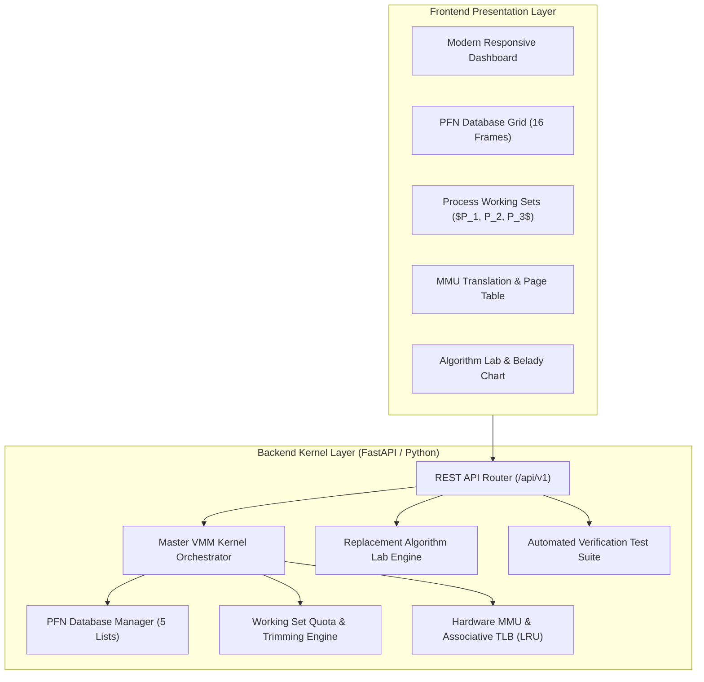
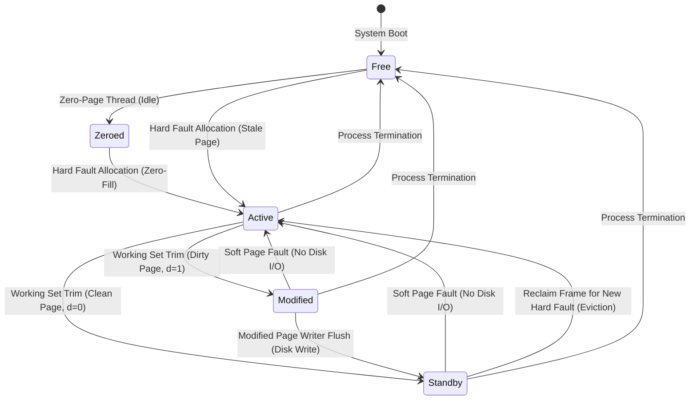

# Windows Memory Manager (VMM) Architecture Simulator

[](https://www.python.org/)
[](https://fastapi.tiangolo.com)
[](https://pytest.org)
[](https://www.docker.com)
[](LICENSE)

An academic, full-stack operating systems simulation modeling the internal virtual memory paging architecture of **Microsoft Windows NT, 10, and 11**. 

Designed as a university capstone / advanced OS coursework project, this platform bridges the gap between simplified textbook paging models and industrial kernel memory architectures by visualizing **multi-process working sets**, the **Page Frame Number (PFN) Database**, **Soft Page Faults**, the **Modified Page Writer**, the **Zero-Page Thread**, hardware **MMU / TLB translation**, and an empirical **Page Replacement Algorithm Lab** with automated **Belady's Anomaly** detection.

---

## 📸 Key Features & Capabilities

- 🏢 **Multi-Process Virtual Address Spaces:** Concurrent isolated processes ($P_1, P_2, P_3$), each operating over 10 virtual pages ($4\text{ KB}$ page size).
- 🧮 **Two-Tier Paging Architecture:** Decouples per-process active **Working Sets** from the global **Page Frame Number (PFN) Database** across 16 physical frames.
- ⚡ **Zero-Disk-I/O Soft Faults:** Visualizes in-memory transition reclamation when touching cached pages resident on the **Standby** or **Modified** lists, eliminating disk I/O.
- 🧹 **Kernel Support Worker Threads:**
  - **Modified Page Writer:** Asynchronously flushes dirty pages ($d=1$) to the paging file (`pagefile.sys`) and demotes frames to Standby.
  - **Zero-Page Thread:** Idle-priority thread converting stale free frames into zero-filled frames for security and zero-fill demand paging.
- 🔍 **Hardware MMU & Associative TLB:** Virtual address decomposition (`VPN` and `Offset`), 4-entry fully associative TLB with LRU eviction, and physical address synthesis (`PA = (PFN << 12) | Offset`).
- 🔬 **6 Pre-Configured Benchmark Scenarios:**
  1. *Good Locality (80/20 Rule)* — High cache hit rate.
  2. *Working Set Thrashing* — Severe memory saturation and disk churn.
  3. *Sequential Scan* — Cache pollution and standby reclamation.
  4. *Severe Memory Pressure* — Frame exhaustion and dynamic quota enforcement.
  5. *Write-Heavy Stress* — Dirty page queueing and modified page writer flushing.
  6. *Process Exit* — Process teardown and bulk frame reclamation to the Free list.
- 🧪 **Replacement Algorithm Experiment Lab:** Empirical evaluation of **FIFO**, **LRU**, **Clock (Second Chance)**, and **Optimal (Belady MIN)** over frame allocations from $1 \dots 10$, featuring real-time graphical anomaly detection.
- 🧪 **Automated Self-Test & Verification Suite:** Embedded verification runner validating algorithmic invariants, physical frame conservation ($16\text{ frames}$ invariant), and scenario counter parity.

---

## 🏛️ System Architecture



---

## 🔄 Windows PFN Database State Machine

In Windows NT/10/11, every physical page frame resides in one of the primary states tracked by the PFN database:



---

## 🚀 Quick Start & Installation

### Option 1: Native Python (Recommended)

1. **Clone the repository:**
   ```bash
   git clone git@github.com:goyalpragun13-wq/windows-memory-manager-simulator.git
   cd windows-memory-manager-simulator
   ```

2. **Install dependencies:**
   ```bash
   pip install -r backend/requirements.txt
   ```

3. **Run the automated test suite:**
   ```bash
   pytest backend/tests -v
   ```

4. **Launch the simulator:**
   - **On Windows:**
     ```cmd
     run.bat
     ```
     *or:*
     ```cmd
     python -m uvicorn app.main:app --app-dir backend --port 8000 --reload
     ```
   - **On Linux / macOS:**
     ```bash
     chmod +x run.sh && ./run.sh
     ```

5. **Open your browser:**
   - Web Application: **[http://localhost:8000](http://localhost:8000)**
   - Interactive Swagger API Documentation: **[http://localhost:8000/docs](http://localhost:8000/docs)**

---

### Option 2: Docker Container

Deploy with a single command:
```bash
docker compose up --build
```
Access the application at `http://localhost:8000`.

---

## 🧪 Automated Verification & Pytest Results

The backend contains **22 comprehensive unit and integration tests** validating simulator logic:

```bash
$ pytest backend/tests -v
============================= test session starts =============================
backend/tests/test_algorithms.py::test_belady_string_known_results PASSED [  4%]
backend/tests/test_algorithms.py::test_belady_anomaly_detection PASSED   [  9%]
backend/tests/test_algorithms.py::test_optimal_minimality PASSED         [ 13%]
backend/tests/test_api.py::test_health_check_endpoint PASSED             [ 18%]
backend/tests/test_api.py::test_simulation_lifecycle_api PASSED          [ 22%]
backend/tests/test_api.py::test_mmu_translation_api PASSED               [ 27%]
backend/tests/test_api.py::test_scenarios_api PASSED                     [ 31%]
backend/tests/test_api.py::test_algorithms_lab_api PASSED                [ 36%]
backend/tests/test_api.py::test_telemetry_self_test_runner PASSED        [ 40%]
backend/tests/test_mmu_translation.py::test_virtual_address_decomposition PASSED [ 45%]
backend/tests/test_mmu_translation.py::test_physical_address_composition PASSED [ 50%]
backend/tests/test_mmu_translation.py::test_tlb_lookup_and_lru_replacement PASSED [ 54%]
backend/tests/test_mmu_translation.py::test_page_table_entry_states PASSED [ 59%]
backend/tests/test_pfn_database.py::test_pfn_initial_state PASSED        [ 63%]
backend/tests/test_pfn_database.py::test_zero_page_thread_conversion PASSED [ 68%]
backend/tests/test_pfn_database.py::test_allocation_priority_zeroed_over_free PASSED [ 72%]
backend/tests/test_pfn_database.py::test_flush_modified_pages_to_standby PASSED [ 77%]
backend/tests/test_pfn_database.py::test_reclaim_process_frames_on_exit PASSED [ 81%]
backend/tests/test_vmm_lifecycle.py::test_initial_hard_fault_and_subsequent_hit PASSED [ 86%]
backend/tests/test_vmm_lifecycle.py::test_working_set_trimming_and_soft_fault PASSED [ 90%]
backend/tests/test_vmm_lifecycle.py::test_dirty_page_trimming_to_modified_list PASSED [ 95%]
backend/tests/test_vmm_lifecycle.py::test_modified_page_writer_flush PASSED [100%]
======================== 22 passed in 1.56s ========================
```

---

## 📂 Repository Structure

```
windows-memory-manager-simulator/
├── .github/
│   └── workflows/
│       └── ci.yml                     # Multi-OS matrix CI pipeline
├── backend/
│   ├── app/
│   │   ├── main.py                    # FastAPI entrypoint & static asset server
│   │   ├── config.py                  # System constants (16 frames, 4KB pages)
│   │   ├── core/                      # Windows VMM simulation kernel
│   │   │   ├── types.py               # PfnState, PageFrame, TLB models
│   │   │   ├── pfn_database.py        # Windows PFN database state machine
│   │   │   ├── mmu.py                 # MMU decomposition & 4-entry LRU TLB
│   │   │   ├── working_set.py         # Working set manager & trimming
│   │   │   ├── vmm.py                 # Master Windows VMM orchestrator
│   │   │   ├── algorithms.py          # FIFO, LRU, Clock, OPT algorithms
│   │   │   └── workloads.py           # Benchmark traces & scenario generator
│   │   ├── schemas/                   # Pydantic request/response validation
│   │   ├── api/v1/                    # Modular REST endpoints (sim, mmu, lab, etc.)
│   │   ├── services/                  # Automated verification test runner
│   │   └── static/                    # Production compiled client application
│   ├── tests/                         # Pytest test suite (100% passing)
│   ├── pytest.ini                     # Pytest configuration
│   └── requirements.txt               # Backend dependencies
├── frontend/                          # Modular frontend development source
│   ├── index.html                     # HTML5 Single Page Application
│   ├── package.json                   # Vite dev scripts
│   ├── vite.config.js                 # Dev server proxy configuration
│   └── src/                           # CSS design tokens & JS controllers
├── docs/                              # Academic laboratory documentation
│   ├── ARCHITECTURE.md                # Subsystem architecture & sequence diagrams
│   ├── WINDOWS_MEMORY_MANAGEMENT.md   # Theoretical operating systems treatise
│   ├── LAB_MANUAL.md                  # Student lab exercises & grading rubric
│   └── API_REFERENCE.md               # REST API specification
├── Dockerfile                         # Production multi-stage Dockerfile
├── docker-compose.yml                 # Local container orchestration
├── run.bat                            # Windows 1-click startup script
├── run.sh                             # Linux/macOS 1-click startup script
├── LICENSE                            # MIT License
└── README.md                          # Project documentation
```

---

## 📖 Theoretical References & Bibliography

1. **Russinovich, M., Solomon, D., & Ionescu, A.** (2017). *Windows Internals, Part 1: System architecture, processes, threads, memory management, and more* (7th ed.). Microsoft Press.
2. **Silberschatz, A., Galvin, P. B., & Gagne, G.** (2018). *Operating System Concepts* (10th ed.). John Wiley & Sons.
3. **Tanenbaum, A. S., & Bos, H.** (2015). *Modern Operating Systems* (4th ed.). Pearson.
4. **Bélády, L. A.** (1966). *A study of replacement algorithms for a virtual-storage computer*. IBM Systems Journal, 5(2), 78-101.

---

## 📜 License

This project is licensed under the MIT License - see the [LICENSE](LICENSE) file for details.
