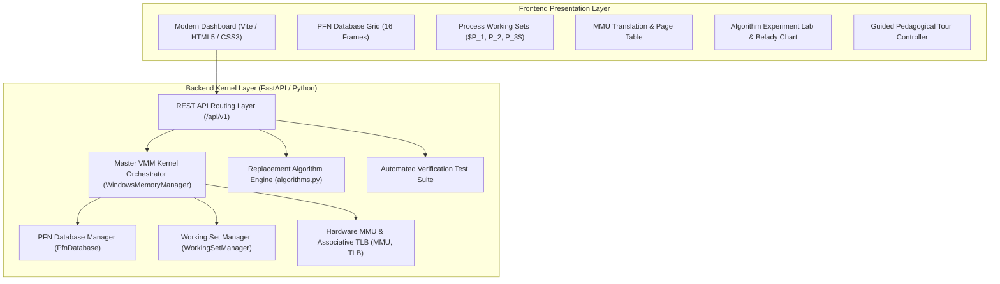
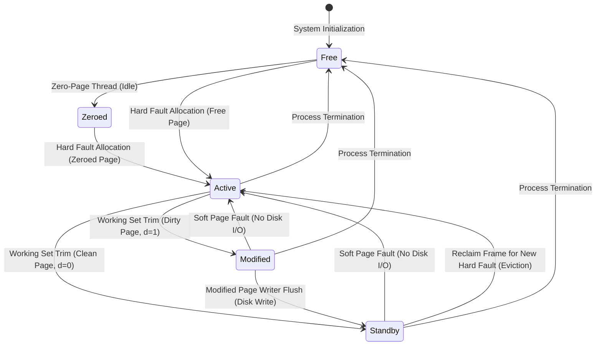
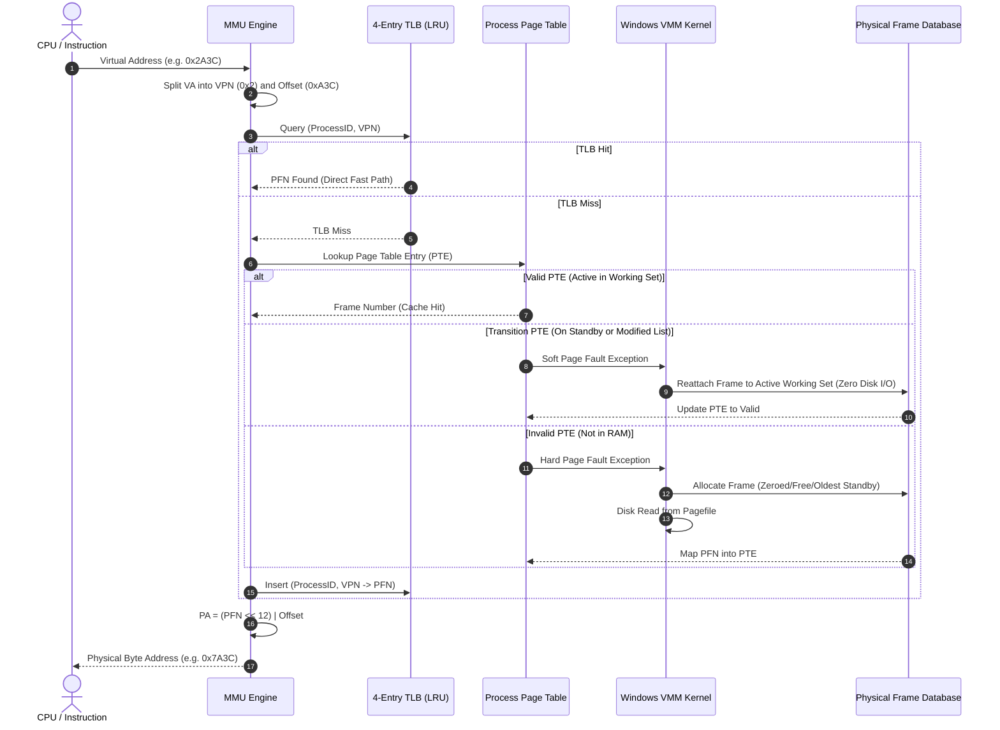

# System Architecture & Technical Design Document

## 1. System Overview
The **Windows Virtual Memory Manager (VMM) Simulator** is an educational, full-stack operating systems laboratory project that models the internal virtual memory paging architecture of Microsoft Windows NT/10/11.

Traditional operating system textbooks typically introduce virtual memory through monolithic global replacement algorithms (e.g. standard Global FIFO or Global LRU across a single flat array of frames). In contrast, production operating systems partition physical memory into per-process working sets and manage unallocated/evicted pages via a centralized Page Frame Database (PFN Database).

This project accurately models:
1. **Per-Process Address Spaces:** Independent virtual address spaces for concurrent processes ($P_1, P_2, P_3$).
2. **Two-Tier Paging Architecture:** Active Process Working Sets combined with the Global PFN Database state machine.
3. **Standby and Modified Lists:** Distinguishing between clean and dirty trimmed pages to enable zero-disk-I/O **Soft Page Faults**.
4. **Modified Page Writer:** Background asynchronous flushing of dirty pages to the paging file (`pagefile.sys`).
5. **Zero-Page Thread:** Background idle-priority zero-filling of free frames to prevent cross-process data leakage.
6. **Hardware MMU & TLB Simulation:** Address decomposition, associative TLB cache lookup with LRU eviction, and physical address calculation.
7. **Empirical Replacement Algorithm Lab:** Comparative evaluation of FIFO, LRU, Clock (Second Chance), and Optimal (Belady MIN), including automated detection of **Belady's Anomaly**.

---

## 2. Component Architecture



---

## 3. PFN Database State Machine

In Windows NT/10/11, every physical page frame resides in one of the primary states tracked by the PFN database:



---

## 4. Hardware MMU & Address Translation Pipeline

The simulated system models 4 KB pages ($2^{12}$ bytes):
- **Virtual Address Format:**
  - High bits ($15:12$): Virtual Page Number (VPN, $0 \dots 9$)
  - Low bits ($11:0$): Byte Offset within Page ($0 \dots 4095$, `0x000` to `0xFFF`)
- **Address Translation Flow:**



---

## 5. Directory Structure & Key Modules

```
windows-memory-manager-simulator/
├── backend/
│   ├── app/
│   │   ├── main.py               # FastAPI entrypoint, static mounting, CORS
│   │   ├── config.py             # System parameters (16 frames, 4KB pages, etc.)
│   │   ├── core/
│   │   │   ├── types.py          # Data models, enums (PfnState, PageFaultType)
│   │   │   ├── pfn_database.py   # Global PFN database state machine
│   │   │   ├── mmu.py            # Address translation & 4-entry LRU TLB
│   │   │   ├── working_set.py    # Process working set quotas & trimming
│   │   │   ├── vmm.py            # Master kernel simulation orchestrator
│   │   │   ├── algorithms.py     # Standalone FIFO, LRU, Clock, OPT algorithms
│   │   │   └── workloads.py      # Reference trace generators & scenarios
│   │   ├── api/v1/               # Modular API routers (sim, mmu, scenarios, lab, telemetry)
│   │   ├── schemas/              # Pydantic validation request/response schemas
│   │   └── static/               # Bundled production web application
│   ├── tests/                    # Comprehensive pytest verification suite (22 tests)
│   └── requirements.txt          # Python dependencies
├── frontend/                     # Modular frontend development workspace
│   ├── index.html                # Application shell
│   ├── vite.config.js            # Vite configuration & backend proxy
│   └── src/                      # CSS design tokens & JavaScript client controller
├── docs/                         # Academic documentation & lab manuals
├── Dockerfile                    # Containerization specification
├── docker-compose.yml            # Container orchestration
├── run.bat / run.sh              # 1-click startup automation scripts
└── README.md                     # University capstone presentation README
```
